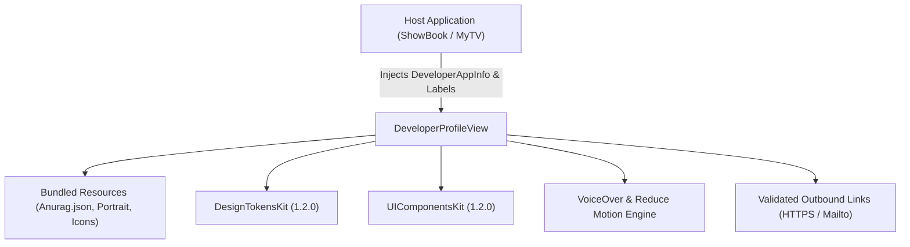

# DeveloperProfileKit

A dedicated Swift package encapsulating Anurag Chourasia's "Know Your Developer" profile experience for portfolio applications (MyTV and ShowBook).


---

## Architecture



`DeveloperProfileKit` separates developer identity and visual presentation from host app business logic:

1. **Bundled Asset & Profile Ownership**:
   - The package encapsulates the portrait artwork, vector social icons (GitHub, LinkedIn, Gmail, CV), and structured JSON bio (`Anurag.json`).
   - `DeveloperProfile.anurag` decodes the immutable profile with zero external network requests.
2. **Host App Decoupling**:
   - `DeveloperAppInfo`: Injected by the host app (app name, version string, build number, legal disclaimer).
   - `DeveloperProfileLabels`: Allows customized localization of screen titles and section headers without creating couplings to specific app localization bundles.
3. **Adaptive Accessibility & Motion Awareness**:
   - Automatically adapts layout between grid and list based on Dynamic Type accessibility sizes.
   - Respects `accessibilityReduceMotion` and VoiceOver by providing immediate, un-animated biography expansions rather than sequential typing animations.
4. **Strict Concurrency**:
   - Fully compatible with Swift 6 complete concurrency checking (`Sendable` models, actor-isolated rendering).

---

## Use Cases

- **"Know Your Developer" / About Screen**: Seamlessly embed a professional, accessible developer profile and portfolio credits screen in iOS applications.
- **Career & Social Networking**: Expose verified outbound links to professional channels (GitHub, LinkedIn, Email, Resume/CV) with safe URL validation.
- **Multi-App Shared Credits**: Ensure consistent developer representation across personal projects while allowing app-specific versioning and attribution.

---

## Practical Code Examples

### 1. Basic Integration in a SwiftUI View

```swift
import SwiftUI
import DeveloperProfileKit

struct AboutScreen: View {
    var body: some View {
        NavigationStack {
            DeveloperProfileView(app: DeveloperAppInfo(
                name: "ShowBook",
                version: Bundle.main.infoDictionary?["CFBundleShortVersionString"] as? String ?? "1.0",
                build: Bundle.main.infoDictionary?["CFBundleVersion"] as? String ?? "1",
                disclaimer: "Book metadata and cover artwork courtesy of Open Library."
            ))
            .navigationTitle("Developer Profile")
        }
    }
}
```

### 2. Customizing Labels and Disclaimer

```swift
import SwiftUI
import DeveloperProfileKit

struct CustomizedDeveloperScreen: View {
    let customLabels = DeveloperProfileLabels(
        role: "Lead iOS Architect",
        biographyHeader: "About Me",
        socialLinksHeader: "Get in Touch",
        appInfoHeader: "Application Details"
    )

    var body: some View {
        DeveloperProfileView(
            app: DeveloperAppInfo(
                name: "MyTV",
                version: "2.4.0",
                build: "108",
                disclaimer: "EPG data and stream availability provided by community endpoints."
            ),
            labels: customLabels
        )
    }
}
```

### 3. Programmatically Accessing the Bundled Profile

```swift
import DeveloperProfileKit

let profile = DeveloperProfile.anurag
print("Developer: \(profile.name)")
print("Primary Role: \(profile.role)")
for link in profile.links {
    if link.canOpen {
        print("Connected via \(link.title): \(link.url)")
    }
}
```

---

## Release Version Controlling

`DeveloperProfileKit` follows strict [Semantic Versioning (SemVer 2.0.0)](https://semver.org/spec/v2.0.0.html):

| Release Level | Criteria | Example Tag |
| :--- | :--- | :--- |
| **MAJOR** (`X.0.0`) | Breaking changes to profile APIs or required dependencies | `v2.0.0` |
| **MINOR** (`1.X.0`) | New profile features, updated artwork assets, new social channels | `v1.1.0` |
| **PATCH** (`1.0.X`) | Bug fixes, typo corrections, accessibility enhancements | `v1.0.1` |

- **Release Documentation**: All updates are tracked in [CHANGELOG.md](CHANGELOG.md).
- **Tag Validation**: Release tags follow the `vX.Y.Z` format, verified via `bash Scripts/verify-release-version.sh`.
- **SPM Integration**:
  ```swift
  .package(url: "https://github.com/Anurag-Chourasia/DeveloperProfileKit.git", exact: "1.0.0")
  ```

---

## Quality & CI Verification

Pull requests and `main` pushes are automatically validated through continuous integration:

1. **SwiftLint Gate**:
   - Pinned SwiftLint 0.65.1 enforcement (`.swiftlint.yml`).
   - Zero-warning strict mode (`--strict`).
   - Run locally: `bash Scripts/lint.sh`.
2. **Build & Test Gate**:
   - Compilation and test execution with `-strict-concurrency=complete` and `-warnings-as-errors`.
   - Host unit tests verifying profile asset decoding and link safety.
   - iOS Simulator build validation.
