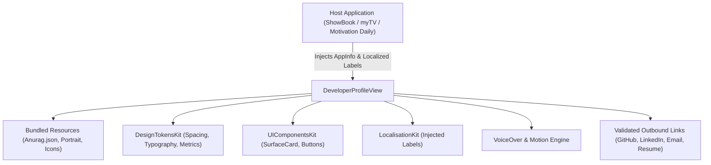
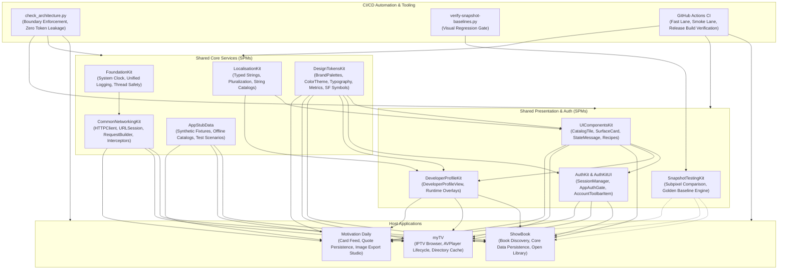

# DeveloperProfileKit

A dedicated, accessible Swift package encapsulating Anurag Chourasia's "Know Your Developer" profile, credits, and portfolio experience for multi-app architectures.


---

## 1. Executive Summary & Purpose

`DeveloperProfileKit` provides a reusable, accessible developer bio and credits screen across **ShowBook**, **myTV**, and **Motivation Daily**. It standardizes author attribution, verified outbound professional links, and app metadata display while remaining cleanly decoupled from host domain models.

### Key Engineering Objectives:
- **Zero-Network Profile Bundling**: Encapsulates portrait artwork, social icons, and structured developer biography (`Anurag.json`) inside the package bundle, eliminating network dependencies.
- **Injected Host Metadata (`DeveloperAppInfo`)**: The host application injects app-specific branding, marketing version, build number, and legal disclaimers.
- **Injected Localization (`DeveloperProfileLabels`) (IOS-59)**: Screen titles, section headers, and outbound link descriptions are localized via caller injection, preventing rigid bundle coupling.
- **VoiceOver & Motion Accessibility**: Respects `accessibilityReduceMotion` by bypassing typing animations, and outlines explicit VoiceOver navigation ordering.

---

## 2. Architecture & Design Principles



### Architectural Tenets:
1. **Host App Decoupling**: Contains no business logic or API endpoints of the host applications; strictly renders developer attribution.
2. **Swift 6 Concurrency Compliance**: All models (`DeveloperProfile`, `DeveloperAppInfo`, `DeveloperProfileLabels`) conform to `Sendable`.
3. **Safe Outbound Dispatching**: Validates and sanitizes outbound HTTPS/mailto URLs before handing off to iOS `openURL`.

---

## 3. Dependency Graph & Consumer Matrix

| Direction | Package / Project | Responsibility |
|---|---|---|
| **Upstream Dependencies** | **DesignTokensKit** (`v1.22.3`) | Spacing, corner radius, touch targets, and typography tokens. |
| | **UIComponentsKit** (`v1.9.0`) | Surface cards, message banners, and accessible button styling. |
| | **LocalisationKit** (`v0.8.1`) | Injected localization string resolution. |
| **Downstream Consumers** | **ShowBook** | "Know Your Developer" screen in the slide-out navigation menu. |
| | **myTV** | About & Credits screen in the sidebar navigation sheet. |
| | **Motivation Daily** | Developer profile and share studio attribution view. |

---

## 4. API Contracts & Practical Code Examples

### 1. Injected Host Profile Integration
```swift
import SwiftUI
import DeveloperProfileKit
import LocalizationKit

struct AboutScreen: View {
    @Environment(\.dismiss) var dismiss

    var body: some View {
        NavigationStack {
            DeveloperProfileView(
                appInfo: DeveloperAppInfo(
                    appName: "ShowBook",
                    version: "1.0.0",
                    buildNumber: "42",
                    disclaimer: "ShowBook utilizes the public Open Library API."
                ),
                labels: DeveloperProfileLabels(
                    title: L10n.About.title.localized,
                    biographyHeader: L10n.About.bioHeader.localized,
                    experienceHeader: L10n.About.experienceHeader.localized,
                    connectHeader: L10n.About.connectHeader.localized
                )
            )
            .toolbar {
                ToolbarItem(placement: .topBarTrailing) {
                    Button(action: { dismiss() }) {
                        Image(systemName: "xmark.circle.fill")
                            .foregroundColor(.secondary)
                    }
                }
            }
        }
    }
}
```

---

## 5. Verification & Testing

```sh
# Run DeveloperProfileKit unit tests and JSON decoding validation
swift test

# Validate architectural boundaries and symbol tokenization
python3 /path/to/UIComponentsKit/Scripts/check_architecture.py --workspace-root /path/to/Projects
```

---

## 6. End-to-End Ecosystem Connectivity



---

## 7. Canonical Notion Dashboards & Governance Links

- [iOS Portfolio — Engineering Tickets Dashboard](https://app.notion.com/p/c20d7f4b133b44499c8ac0b4d5f6249e?pvs=204)
- [iOS Portfolio — Master Document](https://app.notion.com/p/40ffa5f855b98192ad2ede66a5d36fe7)
- [Architecture Boundary Validator (`check_architecture.py`)](file:///Users/anuragchourasia/Desktop/Projects/UIComponentsKit/Scripts/check_architecture.py)
- [Release & Gate Policy Documentation (`Docs/MASTER.md`)](file:///Users/anuragchourasia/Desktop/Projects/Docs/MASTER.md)
